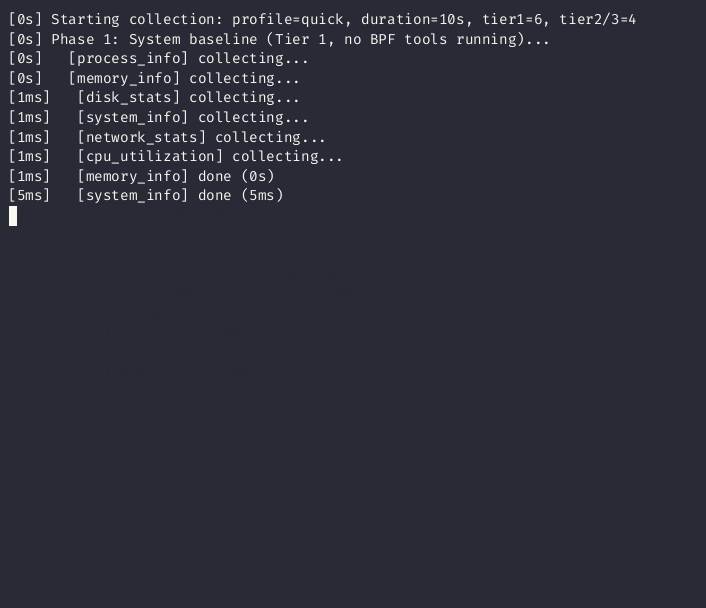

# melisa



melisa is a point-in-time Linux performance diagnostic tool. It collects data through 8 procfs/sysfs collectors, a registry of 67 BCC tools, and one native eBPF collector, then produces a JSON report with raw measurements, threshold-based anomalies, a heuristic health score, and suggested tuning actions. It works as a standalone CLI or as an MCP server for interactive analysis.

[](https://go.dev)
[](LICENSE)
[](https://github.com/iovisor/bcc)
[]()

```bash
sudo melisa collect --profile quick -o report.json
```

The command writes a JSON report to `report.json` (`-o -` selects stdout). Total runtime depends on the selected profile, host, and available collection tools.

---

## Key Features

| Feature | What it does |
|---------|-------------|
| **Health Score** | Heuristic 0–100 summary derived from USE metrics and detected anomalies |
| **37 Anomaly Rules** | Static thresholds over current values and, where applicable, two-point rate measurements |
| **Recommendations** | Suggested tuning commands with evidence, tagged as "fix" or "optimization"; review before applying |
| **67 BCC Tool Specifications** | Histogram, event, and stack-trace parsers; actual availability depends on the host |
| **GPU/PCIe Topology** | NVIDIA GPU metrics, PCI→NUMA mapping, and cross-NUMA GPU-NIC pair detection |
| **Page Reclaim Tracking** | Direct reclaim rates, compaction stalls, and THP split counters |
| **NUMA Analysis** | Per-node miss ratio, distance matrix, and CPU mapping |
| **Network Data** | Conntrack, softnet, IRQ distribution, accept queues, and TCP/UDP sysctls |
| **MCP Server** | MCP access over stdio for interactive diagnostics |
| **Before/After Diff** | Comparison of health scores, USE metrics, anomalies, and histograms |
| **Observer Effect Mitigation** | Tier 1 baselines run before BCC/eBPF tools; PID exclusion and overhead measurement |
| **Documentation** | 22 chapters in English and Russian covering Linux performance and melisa internals |

---

## Quick Start

```bash
# Build (requires Go 1.27+, cross-compile from macOS/Linux)
GOOS=linux GOARCH=amd64 CGO_ENABLED=0 go build -o melisa ./cmd/melisa/

# Deploy and run
scp melisa root@server:/usr/local/bin/
ssh root@server "melisa collect --profile quick -o /tmp/report.json"

# Install BCC tools (first time only)
ssh root@server "melisa install"
```

The CLI does not require a configuration file. Tier 2 tools are optional and can be installed with `melisa install`.

---

## MCP Server

melisa includes a built-in [Model Context Protocol](https://modelcontextprotocol.io/) server. AI agents connect over stdio and interactively diagnose system performance.

**Claude Desktop / Cursor config** (`claude_desktop_config.json`):

```json
{
  "mcpServers": {
    "melisa": {
      "command": "ssh",
      "args": ["root@your-server", "/usr/local/bin/melisa", "mcp"]
    }
  }
}
```

### MCP Tools

| Tool | What it does |
|------|-------------|
| `get_health` | Tier 1 collection with health score and anomalies |
| `collect_metrics` | Collection using a selected `profile`, with optional `focus` and `pid` filters |
| `explain_anomaly` | Possible causes and suggested actions for an anomaly ID |
| `list_anomalies` | All 37 anomaly metric IDs with descriptions |

### Typical AI Workflow

```
Agent                              melisa
  │                                   │
  ├── get_health ──────────────────►  │  "score: 68, cpu_utilization CRITICAL"
  │                                   │
  ├── explain_anomaly ─────────────►  │  "Possible causes, what to check, suggested actions..."
  │   anomaly_id: cpu_utilization     │
  │                                   │
  ├── collect_metrics ─────────────►  │  JSON: available BCC tools, histograms,
  │   profile: standard               │  events, stack traces, AI prompt
  │                                   │
  └── (agent analyzes & recommends)   │
```

---

## How It Works

Three collection tiers with availability-based fallback:

```
Tier 1: 8 collectors (/proc, /sys, ss, ethtool, nvidia-smi, dmesg)
        Network diagnostics, page reclaim & THP tracking,
        NUMA topology analysis, GPU/PCIe cross-NUMA detection.
        Core procfs/sysfs reads usually need no root. External utilities,
        process data, logs, and some metrics depend on permissions.

Tier 2: 67 BCC tools — runqlat, biolatency, tcpconnlat, etc.
        Root + bcc-tools required. `melisa install` handles setup.

Tier 3: Native eBPF (cilium/ebpf) — tcpretrans kprobe
        Root + kernel ≥ 5.8 + BTF. Does not require BCC for this collector.
```

Collection runs in **two phases** to reduce observer effect on Tier 1 baselines:
1. **Phase 1** — Tier 1 collectors capture baselines before BCC/eBPF startup
2. **Phase 2** — available BCC/eBPF tools run in parallel; their own activity can still affect the system

### Report Structure

| Section | Content |
|---------|---------|
| `summary.health_score` | Heuristic weighted 0-100 score (CPU 1.5x, Memory 1.5x, Disk 1.0x, Network 1.0x) |
| `summary.anomalies[]` | Threshold hits with severity, metric, value, threshold |
| `summary.resources` | USE metrics per resource (utilization, saturation, errors) |
| `summary.recommendations[]` | Suggested commands with `type` (fix/optimization) and evidence; review before applying |
| `categories.*` | Raw data: histograms, events, stack traces per subsystem |
| `ai_context.prompt` | Dynamic prompt with system context and 27 anti-patterns |

---

## Collection Profiles

| Profile | Target collection interval | What runs | Purpose |
|---------|---------------------------|-----------|---------|
| **quick** | 10s | Selected Tier 1 collectors + biolatency, tcpretrans, opensnoop, oomkill | Short health snapshot |
| **standard** | 30s | All available Tier 1 and registered BCC tools | Broader diagnostic report |
| **deep** | 60s | Standard set plus memleak, biostacks, wakeuptime, biotop and other extras | Additional stack and event data |

The intervals control collection, not the total command runtime. Tool startup, external utilities, and shutdown can make a run longer.

```bash
# Quick health check
sudo melisa collect --profile quick -o report.json

# Full analysis with AI prompt
sudo melisa collect --profile standard --ai-prompt -o report.json

# Deep dive focused on disk
sudo melisa collect --profile deep --focus disk -o report.json

# Profile a specific process
sudo melisa collect --profile standard --pid 12345 -o app.json

# Profile a container
sudo melisa collect --profile standard --cgroup /sys/fs/cgroup/system.slice/nginx.service -o nginx.json

# Compare before/after a change
melisa diff before.json after.json -o diff.json
```

---

## Anomaly Detection — 37 Rules

Rate-based rules use two-point sampling (delta over interval) to distinguish current activity from cumulative counters. A threshold hit reports a configured condition; it does not by itself establish a root cause.

| Metric | Warning | Critical | Source |
|--------|---------|----------|--------|
| cpu_utilization | 80% | 95% | /proc/stat |
| cpu_iowait | 10% | 30% | /proc/stat |
| load_average | 2x CPUs | 4x CPUs | /proc/loadavg |
| memory_utilization | 85% | 95% | /proc/meminfo |
| swap_usage | 10% | 50% | /proc/meminfo |
| direct_reclaim_rate | 10/s | 1000/s | /proc/vmstat (rate) |
| compaction_stall_rate | 1/s | 100/s | /proc/vmstat (rate) |
| thp_split_rate | 1/s | 100/s | /proc/vmstat (rate) |
| numa_miss_ratio | 5% | 20% | /sys/devices/system/node |
| disk_utilization | 70% | 90% | /proc/diskstats |
| disk_avg_latency | 5ms | 50ms | /proc/diskstats |
| tcp_retransmits | 10/s | 50/s | /proc/net/snmp (rate) |
| conntrack_usage_pct | 70% | 90% | /proc/sys/net/netfilter |
| softnet_dropped | 1/s | 100/s | /proc/net/softnet_stat (rate) |
| listen_overflows | 1/s | 100/s | /proc/net/netstat (rate) |
| tcp_close_wait | 1 | 100 | ss |
| tcp_rcvq_drop | 1/s | 100/s | /proc/net/netstat (rate) |
| tcp_zero_window_drop | 1/s | 50/s | /proc/net/netstat (rate) |
| listen_queue_saturation | 70% | 90% | ss -tnl fill % |
| irq_imbalance | 5x | 20x | /proc/softirqs (rate) |
| gpu_nic_cross_numa | 1 pair | 1 pair | sysfs PCI NUMA |
| ... and 16 more (BCC histograms, PSI, container, NIC, UDP) | | | |

---

## BCC Tools — 67 Tools

The registry contains 67 tool specifications based on Brendan Gregg's [BPF observability tools](https://www.brendangregg.com/BPF/bcc-tracing-tools.png). Installed tools, kernel compatibility, and output formats vary by host.

| Subsystem | Count | Tools |
|-----------|-------|-------|
| **CPU** | 10 | runqlat, runqlen, cpudist, hardirqs, softirqs, runqslower, cpufreq, cpuunclaimed, llcstat, funccount |
| **Disk** | 21 | biolatency, biosnoop, biotop, bitesize, ext4slower/dist, btrfsslower/dist, xfsslower/dist, nfsslower/dist, zfsslower/dist, fileslower, filelife, mountsnoop, mdflush, scsilatency, nvmelatency, vfsstat |
| **Memory** | 7 | cachestat, oomkill, drsnoop, shmsnoop, numamove, memleak, slabratetop |
| **Network** | 14 | tcpconnlat, tcpretrans, tcprtt, tcpdrop, tcpstates, tcpconnect, tcpaccept, tcplife, udpconnect, sofdsnoop, sockstat, skbdrop, tcpsynbl, gethostlatency |
| **Process** | 9 | execsnoop, opensnoop, killsnoop, threadsnoop, syncsnoop, exitsnoop, statsnoop, capable, syscount |
| **Stacks** | 6 | profile, offcputime, wakeuptime, offwaketime, biostacks, stackcount |

24 tools support `--pid` filtering for per-process analysis.

---

## Manual Usage (without AI)

```bash
# Health score
jq '.summary.health_score' report.json

# All anomalies
jq '.summary.anomalies[]' report.json

# Review suggested recommendations
jq '.summary.recommendations[] | {type, title, commands}' report.json

# Network sysctls
jq '.categories.network[0].data.sysctls' report.json

# Page reclaim pressure
jq '.categories.memory[0].data.reclaim' report.json

# NUMA miss ratio per node
jq '.categories.memory[0].data.numa_nodes[] | {node, miss_ratio, cpus}' report.json

# Top CPU processes
jq '.categories.process[0].data.top_by_cpu[:5]' report.json

# BCC histogram percentiles
jq '.categories.cpu[].histograms[]? | {name, p50, p99, max}' report.json
```

---

## Documentation — 22 Chapters (EN + RU)

Chapters covering Linux performance concepts and melisa implementation:

| Chapters | Topic |
|----------|-------|
| 00-01 | Introduction, Linux fundamentals (/proc, /sys, cgroups, PSI) |
| 02-07 | CPU, Memory, Disk, Network, Process, Container analysis |
| 08-10 | System collector, BCC tools registry, Native eBPF |
| 11-13 | Anomaly detection (37 rules), Recommendations engine, AI integration |
| 14-17 | Report diffing, Orchestrator, Output formats, Appendix |
| **18** | **GPU & PCIe Topology** — nvidia-smi, NUMA mapping, GPUDirect RDMA |
| **19** | **Page Reclaim & THP** — watermarks, direct reclaim, compaction, THP defrag |
| **20** | **NUMA Optimization** — distance matrix, numactl, K8s topology manager |
| **21** | **Production Tuning Checklist** — all sysctls + one-liner tuning script |

All chapters available in English and Russian: [`doc/en/`](doc/en/) | [`doc/ru/`](doc/ru/)

---

## Architecture

```
cmd/melisa/           CLI (cobra) + MCP subcommand
internal/
  ├── collector/       8 Tier 1 collectors + BCC adapter + GPU/PCIe
  ├── executor/        BCC runner, security, output parsers, tool registry
  ├── ebpf/            Native eBPF loader (cilium/ebpf, CO-RE)
  ├── mcp/             MCP server (4 tools, stdio JSON-RPC)
  ├── model/           Types, USE metrics, 37 anomalies, health score
  ├── observer/        PID tracker, overhead measurement
  ├── orchestrator/    Two-phase execution, signal handling, profiles
  ├── output/          JSON, FlameGraph SVG, AI prompt generator
  ├── diff/            Report comparison engine
  └── installer/       Distro detection, package installation
```

**Security**: BCC binaries are checked for root ownership, allowed paths, symlinks, and world-writable permissions. External tools are executed without a shell. Stdout is capped at 50MB per BCC tool.

---

## Requirements

| | Minimum | Notes |
|---|---|---|
| **Build** | Go 1.27+ | Cross-compile: `GOOS=linux GOARCH=amd64` |
| **Tier 1** | Linux procfs/sysfs | Core reads usually need no root; external utilities and some metrics depend on permissions |
| **Tier 2** | Root + bcc-tools | `sudo melisa install` handles installation; some distros also need kernel headers |
| **Tier 3** | Root + kernel ≥ 5.8 with BTF | Falls back to Tier 2 when the native collector is unavailable |

### Integration Test Targets

The Docker-based integration script targets Ubuntu 24.04, Ubuntu 22.04, Debian 12, Fedora 40, and Rocky Linux 9. These scenarios are run manually and are not part of the GitHub Actions workflow.

---

## Development

```bash
go test ./... -v          # unit tests
go test ./... -race       # with race detector
make lint                 # golangci-lint
make build                # build the CLI for the host platform
make test-validation      # Linux + root + stress-ng workload tests
```

---

## Roadmap

- [ ] Concurrent ethtool calls (parallel NIC enrichment)
- [ ] `--compact` flag for 256+ CPU servers
- [ ] Per-cgroup memory pressure tracking
- [ ] AMD ROCm GPU support
- [ ] OpenTelemetry export
- [ ] Web UI for report visualization

---

## Contributing

Contributions welcome! Areas where help is especially appreciated:

- **New BCC tool parsers** — we're at 67/80 of Gregg's toolkit
- **AMD GPU support** — ROCm equivalent of our nvidia-smi integration
- **Documentation** — translations, tutorials, real-world case studies
- **Testing** — malformed input edge cases, container-specific scenarios

Please open an issue first to discuss significant changes.

---

## Troubleshooting

| Problem | Fix |
|---------|-----|
| `tool "X" not found` | `sudo melisa install` |
| `binary "X" not owned by root` | `chown root:root /usr/sbin/X-bpfcc` |
| Empty histogram data | Normal — no events during window |
| `exit status 1` from BCC tool | Check `dmesg` for BPF errors |

---

## Limitations

- **Not a monitoring system.** melisa produces an on-demand snapshot. For continuous monitoring, use tools such as Prometheus, Grafana, or Datadog alongside it.
- **No historical trends or alerting.** Reports describe the collection interval; melisa does not store a time series or run as a daemon.
- **No automatic proof of causality.** Anomalies are independent threshold checks. Correlating them into a root-cause chain requires additional analysis.
- **Heuristic scoring.** Health Score is a weighted heuristic summary, not a calibrated measure of failure probability or overall system health.
- **Recommendations require review.** Suggested sysctls and commands may not be appropriate for every workload; validate them before applying to production.
- **Environment-dependent collection.** BCC tools require root, compatible kernel/BCC versions, and sometimes kernel headers. Tier 1 output can be partial when external utilities, files, or permissions are unavailable.
- **System-level only.** melisa does not explain application-internal causes. Use application profilers and traces for that analysis.
- **NVIDIA GPUs only.** AMD ROCm support is not implemented.

---

## License

[Apache License 2.0](LICENSE)

---

Melisa is derived from [melisai](https://github.com/dmitriimaksimovdevelop/melisai). Original copyright and license notices are preserved in [LICENSE](LICENSE).

**Built on the shoulders of [Brendan Gregg's](https://www.brendangregg.com/) BPF ecosystem, the [USE Method](https://www.brendangregg.com/usemethod.html), and [cilium/ebpf](https://github.com/cilium/ebpf).**
